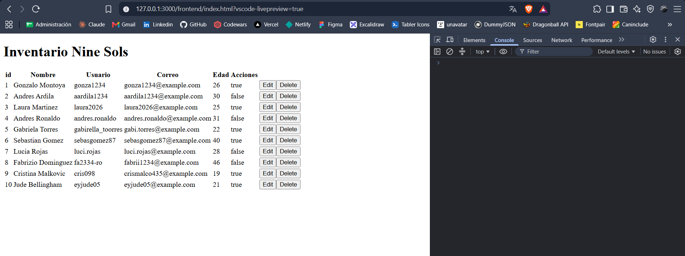

# 🗡️ Inventario Nine Sols (Vanilla JS + Node.js)

## 🎯 Objetivo del Proyecto

Documentar el crecimiento y desarrollo de una aplicación full-stack construida desde cero, aplicando buenas prácticas de control de versiones con ramas (`git-flow`) y Pull Requests.

El propósito principal de este proyecto es afianzar las bases de la ingeniería de software web:

- Integrar correctamente el **Frontend** con el **Backend**.
- Manejar peticiones HTTP nativas para construir un **CRUD completo** (`GET`, `POST`, `PUT`, `DELETE`).
- Dominar el flujo de datos asíncronos (`fetch`, streams).
- Configurar manualmente políticas de CORS y seguridad en un entorno puro de **JavaScript** y **Node.js**, sin depender de frameworks o librerías de terceros.

---

## 📷 Vista previa

---

## 🎮 Contexto de la Aplicación

Una plataforma de registro e inventario orientada a la comunidad de jugadores de **Nine Sols**, permitiendo gestionar perfiles o registros de usuario de forma persistente y controlada desde el servidor.

---

## 🛠️ Stack Tecnológico

- **Frontend:** HTML5, CSS3, JavaScript (Vanilla), Fetch API.
- **Backend:** Node.js (Módulo nativo `http`).
- **Control de Versiones:** Git & GitHub (Metodología de ramas / _Git-flow_).

---

## 📋 Fases de Desarrollo (Roadmap)

El proyecto se construye paso a paso mediante ramas de características (_feature branches_):

1. [x] Estructura inicial y configuración del repositorio.
2. [x] Configuración del servidor nativo en Node.js.
3. [x] Creación del archivo `JSON` y manejo de lectura con el módulo `fs`.
4. [x] Implementación de lectura(`GET`).
5. [x] Html para mostrar los datos desde el backend.
6. [x] `fetch` funcional desde el frontend para comunicarse con el backend.
7. [x] Renderizado e inicialización de datos correcto.
8. [ ] Módulo para crear un nuevo usuario.
9. [ ] Creación de datos (`POST`).
10. [ ] Implementar eliminar usuario (`DELETE`).
11. [ ] Implementación de actualización(`PUT`).
12. [ ] Validaciones tanto en cliente como en servidor.

---

## Version 0.2.0
